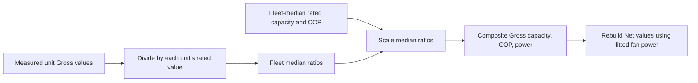
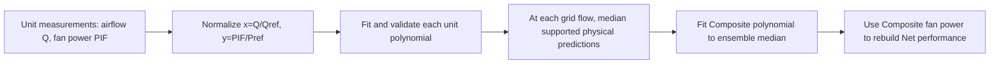
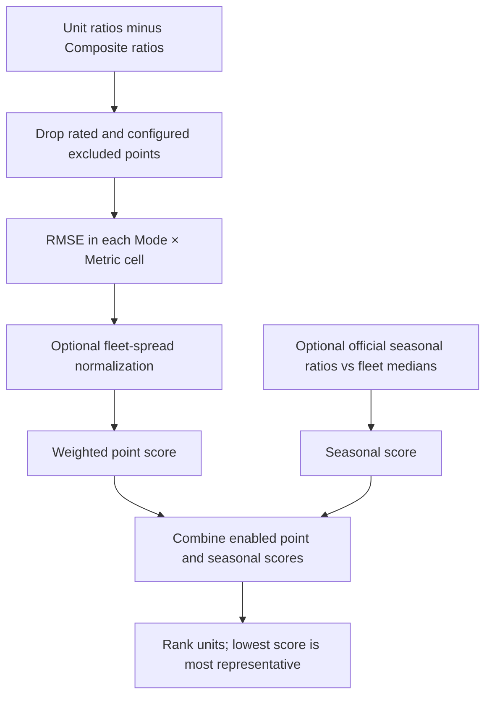

# Representative RTU Performance Data: Companion Guide

How the shared performance tables, fan-curve coefficients and plots were derived from a 10-unit laboratory RTU fleet, and how to read them.

## At a glance

| | |
| --- | --- |
| **Purpose** | Provide measured-based performance data and indoor-fan power curves for a representative RTU, to be combined with other data and assumptions in building energy modeling |
| **Source data** | Laboratory steady-state tests of 10 commercial RTUs (about 4 to 20 tons) at standard Cooling and Heating test points |
| **Approach** | Convert to coil-only (Gross) performance → build a fleet-median **Composite** RTU → rank real units by how closely they match it → deliver the selected real unit ("Archetype") |
| **What you receive** | A data workbook (7 sheets), an HTML/PDF-style report, and key plots, per selected unit. Unit names are anonymized (`RTU-A (10T)`, ...) |
| **Not included** | Fitted coil temperature/flow modifier curves and end-to-end EnergyPlus validation; these are left to the modeling engineer |

> **Top caveats:** results are lab steady-state points, not seasonal or field performance; ratios and fan fits are valid only within the tested range; the Composite is synthetic and is not an independently tested unit.

## Contents

1. [Approach in one page](#1-approach-in-one-page)
2. [Key analysis steps](#2-key-analysis-steps)
3. [What is in the delivery](#3-what-is-in-the-delivery)
4. [Plot guide](#4-plot-guide)
5. [Data guide](#5-data-guide)
6. [Using the data: assumptions and limits](#6-using-the-data-assumptions-and-limits)

---

## 1. Approach in one page

[↑ Back to contents](#contents)

> **In short:** all units are compared on the same footing (coil-only performance, ratios to each unit's rated point). A fleet-median Composite defines the "typical" shape; the real unit closest to it, plus the fleet's official seasonal metrics, is selected as the Archetype.

```text
10 lab-tested RTUs
      |
      v
Convert to coil-only (Gross) performance      <- removes indoor-fan effects so units compare fairly
      |
      v
Ratios to each unit's rated point             <- size-free curve shapes (capacity, efficiency, airflow)
      |
      +--> Fleet-median ratios --> Composite RTU (synthetic, "typical" shape)
      |                                 |
      |                                 v
      |                      Fan curve fits (every unit + Composite)
      v
Score each real unit against the Composite (+ seasonal metrics)
      |
      v
Archetype candidates --> selected unit(s) --> anonymous data, report and plots
```

Why this approach:

- A single real unit may be unusual; a fleet median is not tied to one design.
- A real unit is still more credible for modeling than a synthetic one, so the Archetype is the **real unit that best represents the fleet**, not the highest-efficiency unit.
- Working with ratios makes units of different size comparable, and the delivered absolute values stay the selected unit's own measurements.

---

## 2. Key analysis steps

[↑ Back to contents](#contents)

### 2.1 Test points and rated points

Only steady-state points are used.

| Mode | Points (cold to warm) | Rated reference |
| --- | --- | --- |
| Cooling | D, DHC, C, B, A | **A** |
| Heating | H-10Max; H5Max, H5B2, H5B, H5H; H17B, H17H, H17M, H17L; H47H, H47M, H47L | **H47H** |

Heating names are outdoor temperature (°F) plus speed level: H/M/L = high/mid/low, B/B2 = boost, Max = maximum capacity. Cooling A/B/C/D correspond to levels 1/2/3/4; DHC is a separate dehumidification point.

### 2.2 Net to Gross (coil-only) conversion

> **In short:** DX-coil models describe the coil alone, so the indoor fan and crankcase heater are removed from the as-tested (Net) values.

```text
Return air --> [ DX COIL ] --> [ INDOOR FAN ] --> Supply air
                Gross             adds fan heat

Cooling:  Net capacity = Gross capacity - fan heat
Heating:  Net capacity = Gross capacity + fan heat
Net power = Gross power + indoor fan power
Gross power = compressor + outdoor fan + controls
```

Fan heat = 3.412 × indoor fan power (W) in Btu/h. Gross COP = Gross capacity / (3.412 × Gross power). The conversion assumes all indoor-fan electrical power becomes heat in the airstream (draw-through fan).

### 2.3 Composite RTU

> **In short:** at every test point, take the **median** across the fleet of each unit's ratio to its own rated point, then apply it to the fleet-median rated size.



| Step | Quantity | Rule |
| --- | --- | --- |
| 1 | Unit shape | ratio = value at test point ÷ value at the unit's rated point (capacity, COP, airflow) |
| 2 | Composite Gross | capacity = median rated capacity × median capacity ratio; COP likewise; power = capacity ÷ COP |
| 3 | Airflow, conditions | median ratio applied to median rated airflow; test conditions are fleet medians |
| 4 | Indoor fan power | from the ensemble fan curve (section 2.4), not a median of fan power |
| 5 | Net values | rebuilt from Gross plus fan power so Net capacity, power and efficiency are mutually consistent |

Medians are used so one outlier unit cannot distort the shape, and power is derived from capacity and COP so the three always agree.

Let $u$ index units, $t$ a test point, and $r$ the mode's rated point (`A` or `H47H`). For each quantity $X$:

$$
R_{X,u,t}=\frac{X_{u,t}}{X_{u,r}},\qquad
X_{c,t}=\operatorname{median}_u(X_{u,r})\;\operatorname{median}_u(R_{X,u,t})
$$

For Gross capacity $q$ and Gross COP, Composite Gross power is then:

$$
P_{c,t}^{gross}=\frac{q_{c,t}^{gross}}{COP_{c,t}^{gross}\,K_m},\qquad
K_m=\begin{cases}1 & \text{Cooling}\; (COP=EER2)\\3.412141633 & \text{Heating}\end{cases}
$$

The factor $K_m$ reconciles capacity in Btu/h and power in W. Airflow is similarly scaled by its fleet-median rated value and median airflow ratio. After fan fitting, delivered Net values are rebuilt using the Composite fan power: $q^{net}=q^{gross}-P_{IF}\times3.412141633$ in Cooling, $q^{net}=q^{gross}+P_{IF}\times3.412141633$ in Heating, and $P^{net}=P^{gross}+P_{IF}$.

### 2.4 Indoor fan curves

> **In short:** each unit's fan power vs airflow is fitted with a polynomial normalized at its reference flow; the Composite curve is the median of the supported unit curves.



- Normalized form: fan power fraction = f(x), where x = airflow ÷ reference airflow and f(1) = 1.
- The reference airflow is each unit's highest-airflow test point (the design maximum flow).
- Per unit, a quadratic or cubic is chosen automatically: physically sensible shapes (nonnegative and nondecreasing across the measured range) are preferred, then the lowest leave-one-out error.
- A power law (power fraction = x^n) is also reported as an alternative form.
- Validity is limited to the measured flow range ("support"); the curves are not intended for extrapolation.
- External static pressure (ESP) is recorded, but the curves are not pressure-corrected; effective external fan efficiency is a diagnostic, not total fan efficiency.

For a unit, $x=Q/Q_{ref}$ and $y=P_{IF}/P_{ref}$. The fitted polynomial is normalized to equal one at the reference point:

$$
f_u(x)=\frac{\sum_{k=0}^{d}a_{u,k}x^k}{\sum_{k=0}^{d}a_{u,k}},\qquad
f_u(1)=1,\qquad
\widehat P_{IF,u}(Q)=P_{ref,u}f_u(Q/Q_{ref,u})
$$

Here $d$ is the selected polynomial degree (normally 2 or 3). At an ensemble-grid flow $Q$, the Composite target is the median of unit predictions only where each unit is within its measured flow support and its fitted curve is nonnegative and nondecreasing. The Composite polynomial is fitted to these median targets; its coefficients approximate the ensemble rather than being medians of coefficients.

### 2.5 Archetype selection

> **In short:** each real unit gets a **curve-fit score** (lower is closer to the fleet's typical behavior) from its ratio curves and, optionally, its official seasonal ratings.



**Point matching.** For each Mode × Metric cell, the error at each test point is (unit ratio − Composite ratio). The cell score is the root-mean-square error; cell scores are combined with weights:

```text
score_points = sqrt( sum( w_cell × RMSE_cell^2 ) / sum( w_cell ) )
```

- Rated points (always ratio 1) and H5Max (duplicates the larger of H5B/H5B2) are excluded.
- Some points can be excluded from scoring only (they still appear in the Composite and plots).
- Efficiency can be fitted as COP or as EIR (= 1/COP, the form used by EnergyPlus curves).
- Ratios can be Gross (coil-only, default) or Net (as-tested, including indoor fan).
- Errors can be normalized by each cell's fleet spread so no cell dominates.

**Seasonal matching.** Official seasonal metrics (IVEC for Cooling, IVHE and IVHEc for Heating) are compared with the fleet median: error = unit value ÷ fleet median − 1. They are combined with the point score using their own weights; zero weights give point-only selection.

For unit $u$, mode/metric cell $k$, and test point $i$, let $e_{u,k,i}$ be the unit ratio minus the Composite ratio. The cell RMS error and (optional) normalized error are:

$$
RMSE_{u,k}=\sqrt{\frac{1}{n_{u,k}}\sum_i e_{u,k,i}^2},\qquad
s_k=\sqrt{\operatorname{mean}_{u,i}(e_{u,k,i}^2)},\qquad
E_{u,k}=\begin{cases}RMSE_{u,k}/s_k & \text{if normalized and }s_k>10^{-12}\\RMSE_{u,k} & \text{otherwise}\end{cases}
$$

With $w_k$ the configured cell weights and $W_u$ the weights of cells available for unit $u$:

$$
S_{point,u}=\sqrt{\frac{\sum_k w_k E_{u,k}^2}{W_u}},\qquad W_u=\sum_{k\,available}w_k
$$

For seasonal metric $m$, $e_{u,m}=M_{u,m}/\operatorname{median}_{fleet}(M_m)-1$; it is optionally divided by the fleet RMS seasonal error. If $v_m$ are its weights, the final score is:

$$
S_u=\sqrt{\frac{W_u S_{point,u}^2+\sum_m v_m\widetilde e_{u,m}^{\,2}}{W_u+\sum_m v_m}}
$$

When all seasonal weights are zero, $S_u=S_{point,u}$. Missing values for an enabled seasonal metric make a unit ineligible. The lowest eligible score ranks first.

> Above or below the median both count as deviation. The method selects a **representative** unit, not the most efficient one.

| Setting in this delivery | Value |
| --- | --- |
| Ratio basis | Gross |
| Efficiency fitted | EIR |
| Cells weighted | Heating capacity and Heating EIR (equal); Cooling cells 0 |
| Normalization | off (raw ratio errors) |
| Seasonal weights | IVHE 0.5, IVHEc 0.5, IVEC 0 |
| Excluded from scoring only | Cooling DHC, Heating H5B2 |
| Candidates reported | top 4 |

> These are the settings recorded in the workbook's `Assumptions & Units` sheet; they change if the analysis is rerun with different options.

### 2.6 Heating operating levels and boost points

H5Max duplicates the larger of H5B and H5B2. It is compared with each (within a 5 % tolerance on the configured metrics); if it matches, Max points at all temperatures are labelled with that boost level (B2 on ties). Unmatched or conflicting Max points stay separate. Original labels and the mapping decision are kept in the data. Mapping a Max point to a boost level at other temperatures is an operating-level assumption, not a measured equality.

---

## 3. What is in the delivery

[↑ Back to contents](#contents)

> **In short:** per selected unit: one workbook, one report and a set of PNG plots; the name of the unit is anonymized inside the files.

| Item | Description |
| --- | --- |
| `Representative_RTU_Data_<alias>.xlsx` | Seven data-only sheets (section 5) |
| `Representative_RTU_Report_<alias>.html` | Same tables plus assumptions, in a printable page |
| `*.png` plots | Selected-unit comparison plots (section 4) |
| `<alias>` | Anonymous name, e.g. `RTU-F (10T)`: letter in a fixed fleet order, size in rounded tons |

---

## 4. Plot guide

[↑ Back to contents](#contents)

> **In short:** the selected unit is highlighted (`Archetype: <alias>`); the rest of the fleet (colored dots) and the Composite (black diamond) provide context.

| Plot | What it shows | How to read it |
| --- | --- | --- |
| **Composite + Archetype vs Fleet**, one per mode | Capacity, efficiency and power vs outdoor temperature, Gross basis | Whether the selected unit sits near the middle of the fleet and the Composite |
| **Ratio curves vs fleet**, one per mode | Capacity, efficiency and airflow as ratios to the rated point | Shape comparison independent of size; 1.0 = rated point |
| **Ratio curves by test name** | Same ratios, plotted by test point | Where along the test sequence the unit departs from the fleet |
| **Gross capacity / EIR / airflow ratios** | EIR (= 1/COP) in place of COP | The view matching EnergyPlus EIR-vs-temperature curves |
| **Heating operating-level curves** | Capacity, COP or EIR, airflow ratios vs outdoor temperature, one line per speed level (selected unit only); extended copies add dashed linear tails over the plotted temperature range | Level-by-level heating behavior. Tails are visual extensions, not measured data |
| **Fan power vs flow fraction** | Fan power fraction vs flow fraction with polynomial and power-law fits and equations | The delivered fan curve; the fit is valid only across the measured flow range |
| **Fan fit comparison** | Polynomial (left) and power-law (right) fits for all units and the Composite | How typical the selected unit's fan behavior is |
| **IVEC / IVHE / IVHEc comparison** | Official seasonal ratings across the fleet (box + points), Composite and selected unit marked | Where the selected unit sits among the fleet's seasonal ratings |

Conventions: colors identify units and stay the same across plots; marker shapes identify the Composite and the selected unit; titles state the basis (Gross or Net); every plot with a unit name uses the anonymous alias.

---

## 5. Data guide

[↑ Back to contents](#contents)

> **In short:** one row per test point in the Heating and Cooling sheets, in SI units, with both Gross and Net values and ratios to the rated point.

| Sheet | Contents |
| --- | --- |
| **Heating Data** | Original Heating test points (mapping metadata first), inlet conditions, capacity, total power, fan power, airflow, COP and EIR (Gross and Net) and ratios to H47H |
| **Cooling Data** | Same layout for Cooling; DHC identified separately; ratios to A |
| **Rated References** | Rated-point conditions and performance, normalization values, size and seasonal ratings |
| **Fan Parameters** | Reference airflow, reference fan power, reference ESP, supported flow range, data basis |
| **Fan Coefficients** | Selected degree, normalized polynomial coefficients (ascending powers), alternative power-law exponent, readable equations |
| **Key QA** | Missing-data checks, power-balance residuals, fan fit quality, support and shape warnings, H5 mapping decision |
| **Assumptions & Units** | Methods, settings, unit conversions and scope |

**Units:** capacity and power in W; COP and EIR in W/W (EIR = 1/COP; Cooling EER is converted); inlet temperatures in °C; airflow in m³/s; ESP in Pa.

**Columns to know:**

| Column group | Meaning |
| --- | --- |
| Gross | Coil-only values (indoor fan removed) |
| Net | As-tested values, including indoor fan |
| Ratios | Value at the test point ÷ value at the mode's rated point (A or H47H) |
| Airflow, fan power | Basis-independent (one column each) |
| Level / Original Level / Mapping status | Heating level after boost mapping, the original label, and how the mapping was decided |

**Fan equation:** with x = airflow ÷ reference airflow, power fraction y = a0 + a1·x + a2·x² (+ a3·x³), normalized so y(1) = 1. Fan power = y × reference fan power.

---

## 6. Using the data: assumptions and limits

[↑ Back to contents](#contents)

> **In short:** the tables are lab steady-state points and fan fits; the engineer must add the temperature/flow modifier curves and validate the full model.

| Topic | Note |
| --- | --- |
| Scope | Performance tables and fan polynomials only; coil modifier fitting and EnergyPlus validation are not included |
| Rated references | Ratios use A (Cooling) and H47H (Heating); they are mode-level references, not speed-specific modifiers |
| Co-varying conditions | Speed, indoor conditions, airflow and outdoor temperature change together across test points, so full modifier curves cannot be isolated from these data alone |
| Gross conversion | Assumes all indoor-fan power becomes heat in the airstream; crankcase heater power is excluded from Net total power |
| Power balance | Manufacturer-reported Net totals sometimes do not equal the sum of components; deviations are reported in Key QA, not corrected |
| Fan curves | Valid only over the measured flow range; they do not account for internal coil/filter losses or different static pressures; zero-flow intercept is not an instruction to run the fan when off |
| Boost mapping | Matching Max to B2/B across temperatures is an assumption; original labels are kept |
| Plot extensions | Dashed tails on operating-level plots are visual only |
| Seasonal ratings | Official protocol values, not recomputed after test-point exclusions; they are not validation of the delivered fan curve |
| Uncertainty | Low-count points and fleet variation are reported, not replaced by assumed data; measurement uncertainty is not quantified |
